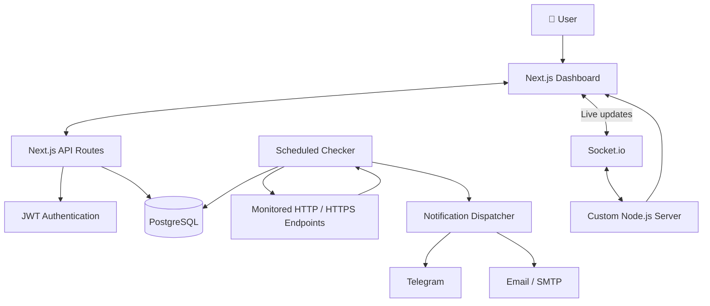

 <div align="center">

# 🛡️ UptimeGuard

### Your infrastructure. Your monitors. Your peace of mind.

**A self-hosted uptime monitoring platform built for developers who want full control — without recurring subscriptions.**

Monitor your endpoints, track incidents, visualize uptime, and receive real-time alerts from infrastructure you own.

[](https://nextjs.org/)
[](https://www.typescriptlang.org/)
[](https://www.postgresql.org/)
[](https://www.prisma.io/)
[](https://www.docker.com/)
[](LICENSE)

<br />

[**Features**](#-features) · [**Quick Start**](#-quick-start) · [**Architecture**](#-architecture) · [**API**](#-api-reference) · [**Contributing**](#-contributing)

</div>

---

## ✨ Why UptimeGuard?

Your monitoring platform should work for you — not the other way around.

UptimeGuard is a self-hosted alternative to commercial uptime monitoring services. Run it on your own server, manage your monitors from one dashboard, and receive notifications when something goes wrong.

No vendor lock-in. No mandatory subscription. Just a monitoring stack you control.

<table>
<tr>
<td width="50%">

### 🎯 Complete Visibility

Monitor HTTP and HTTPS endpoints, inspect response times, review uptime history, and keep track of incidents.

</td>
<td width="50%">

### ⚡ Real-Time Updates

Get live dashboard updates powered by Socket.io, without constantly refreshing the page.

</td>
</tr>
<tr>
<td width="50%">

### 🔔 Instant Notifications

Receive alerts through Telegram and email when monitored services become unavailable.

</td>
<td width="50%">

### 🏠 Self-Hosted by Design

Keep your monitoring infrastructure and database under your control with PostgreSQL and Docker.

</td>
</tr>
</table>

---

## 🚀 Features

| Feature                 | What you get                                                              |
| :---------------------- | :------------------------------------------------------------------------ |
| **HTTP Monitoring**     | HTTP/HTTPS checks with GET, POST, PUT, and DELETE methods                 |
| **Custom Requests**     | Configure request headers, request bodies, timeouts, and keyword matching |
| **Flexible Scheduling** | Configure check intervals from 1 to 60 minutes                            |
| **Live Dashboard**      | Real-time monitor status updates with Socket.io                           |
| **Uptime History**      | Visual uptime bars, response-time charts, and historical data             |
| **Incident Tracking**   | Automatically record incidents, resolution times, and durations           |
| **Telegram Alerts**     | Get monitoring notifications through a Telegram bot                       |
| **Email Alerts**        | Send notifications using your SMTP server                                 |
| **Alert Cooldown**      | Reduce repeated notifications with configurable cooldowns                 |
| **Authentication**      | JWT access and refresh tokens with bcrypt password hashing                |
| **User Isolation**      | Keep monitor and account data separated between users                     |
| **Modern Interface**    | Responsive layouts, dark and light themes, and smooth animations          |
| **Background Checks**   | Scheduled HTTP checks with configurable concurrency                       |
| **Database Management** | PostgreSQL persistence with Prisma ORM                                    |
| **Docker Deployment**   | Containerized deployment for a reproducible environment                   |

---

## 🖥️ Built for a Better Developer Experience

UptimeGuard combines a modern web interface with a practical monitoring backend.

- **At a glance:** See service availability and response-time trends.
- **Investigate incidents:** Review monitor history to understand when a service failed.
- **Stay informed:** Configure notification channels that fit your workflow.
- **Keep control:** Host the application wherever you prefer.
- **Extend your stack:** Work with a familiar TypeScript, PostgreSQL, and Docker ecosystem.

> **The goal:** Make uptime monitoring straightforward, transparent, and accessible on your own infrastructure.

---

## 🧰 Tech Stack

<table>
<thead>
<tr>
<th>Layer</th>
<th>Technology</th>
</tr>
</thead>
<tbody>
<tr>
<td><strong>Frontend</strong></td>
<td>Next.js 14, React 18, TypeScript, Tailwind CSS</td>
</tr>
<tr>
<td><strong>UI & Visualization</strong></td>
<td>Radix UI, Recharts, Framer Motion, next-themes</td>
</tr>
<tr>
<td><strong>Backend</strong></td>
<td>Next.js API Routes, custom Node.js server, Socket.io</td>
</tr>
<tr>
<td><strong>Monitoring Engine</strong></td>
<td>node-cron, axios, p-limit</td>
</tr>
<tr>
<td><strong>Database</strong></td>
<td>PostgreSQL 16, Prisma ORM</td>
</tr>
<tr>
<td><strong>Authentication</strong></td>
<td>JWT, bcryptjs, Zod</td>
</tr>
<tr>
<td><strong>Notifications</strong></td>
<td>Nodemailer, SMTP, Telegram Bot API</td>
</tr>
<tr>
<td><strong>Infrastructure</strong></td>
<td>Docker, Docker Compose</td>
</tr>
</tbody>
</table>

---

## 🏗️ Architecture

UptimeGuard separates the user interface, API, scheduled monitoring, and persistent storage into a straightforward application architecture.



### How it works

1. **Configure monitors** through the dashboard.
2. **Run scheduled checks** against monitored HTTP/HTTPS endpoints.
3. **Store results and incidents** in PostgreSQL.
4. **Send notifications** through configured Telegram or email integrations.
5. **Update the dashboard** in real time using Socket.io.

_The diagram represents the intended high-level architecture; exact runtime behavior depends on the application configuration._

---

## ⚡ Quick Start

Get a local development instance running in a few steps.

### Prerequisites

Make sure you have installed:

- [Node.js 18 or later](https://nodejs.org/)
- [Docker Desktop](https://www.docker.com/products/docker-desktop/) or Docker Engine with Compose
- npm, yarn, or pnpm

### 1. Clone the repository

```bash
git clone https://github.com/thepradohigh/UptimeGuard.git

cd UptimeGuard
```

### 2. Install dependencies

```bash
npm install
```

### 3. Start PostgreSQL

```bash
docker-compose up -d
```

### 4. Configure environment variables

Create your local environment file:

```bash
cp .env.example .env
```

Open `.env` and configure the required secrets and database connection.

> **Security:** Use unique, randomly generated JWT secrets. Never commit your `.env` file or production credentials to Git.

### 5. Initialize the database

```bash
npx prisma generate
npx prisma db push
npx prisma db seed
```

These commands generate the Prisma client, synchronize the database schema, and load seed data if the project's seed script is configured.

### 6. Start the application

```bash
npm run dev
```

Open the dashboard:

**http://localhost:3000**

That's it — your local development environment is ready to explore.

> **Demo account:** `demo@uptimeguard.dev` / `demo123456`
> These credentials are intended for the seeded development environment, if supported by the current seed script. Change or remove demo credentials before exposing an instance publicly.

---

## ⚙️ Configuration

UptimeGuard uses environment variables for database access, authentication, notification delivery, and monitoring behavior.

| Variable              | Default            | Description                                      |
| :-------------------- | :----------------- | :----------------------------------------------- |
| `DATABASE_URL`        | Project-configured | PostgreSQL connection string                     |
| `JWT_SECRET`          | —                  | **Required.** Secret used to sign access tokens  |
| `JWT_REFRESH_SECRET`  | —                  | **Required.** Secret used to sign refresh tokens |
| `SMTP_HOST`           | —                  | SMTP server hostname                             |
| `SMTP_PORT`           | `587`              | SMTP server port                                 |
| `SMTP_USER`           | —                  | SMTP authentication username                     |
| `SMTP_PASS`           | —                  | SMTP authentication password                     |
| `SMTP_FROM`           | —                  | Sender address for email notifications           |
| `TELEGRAM_BOT_TOKEN`  | —                  | Telegram bot API token                           |
| `NOTIFY_COOLDOWN`     | `5`                | Cooldown between repeated alerts, in minutes     |
| `MAX_MONITORS`        | `50`               | Configured monitor limit per user                |
| `CHECKER_CONCURRENCY` | `10`               | Maximum number of concurrent checks              |

**Important:** Defaults and required settings should be verified against your current `.env.example`, configuration code, and deployment files.

### Generating secure JWT secrets

Generate independent secrets for access and refresh tokens:

```bash
openssl rand -base64 32
openssl rand -base64 32
```

Use the generated values for `JWT_SECRET` and `JWT_REFRESH_SECRET`, respectively.

---

## 📁 Project Structure

```text
UptimeGuard/
├── prisma/
│   ├── schema.prisma          # Database models and enums
│   └── seed.ts                # Demo data seeder
├── src/
│   ├── app/
│   │   ├── (auth)/            # Login and registration
│   │   ├── (dashboard)/       # Protected dashboard pages
│   │   │   ├── dashboard/     # Overview and charts
│   │   │   ├── monitors/      # Monitor management
│   │   │   ├── incidents/     # Incident history
│   │   │   └── settings/      # Profile and notifications
│   │   ├── api/
│   │   │   ├── auth/          # Authentication endpoints
│   │   │   ├── monitors/      # Monitor CRUD and statistics
│   │   │   ├── incidents/     # Incident queries
│   │   │   └── user/          # User profile
│   │   └── layout.tsx         # Root layout and providers
│   ├── components/
│   │   ├── ui/                # Reusable UI components
│   │   ├── monitors/          # Monitor-specific components
│   │   └── layout/            # Sidebar, header, theme toggle
│   ├── lib/
│   │   ├── auth.ts            # Authentication utilities
│   │   ├── checker.ts         # Background HTTP checker
│   │   ├── notifications.ts   # Email and Telegram dispatch
│   │   ├── prisma.ts          # Prisma client
│   │   └── socket.ts          # Socket.io client setup
│   └── server.ts              # Custom Next.js + Socket.io server
├── docker-compose.yml         # PostgreSQL service
├── Dockerfile                 # Container build
├── tsconfig.server.json       # Server TypeScript configuration
└── package.json               # Dependencies and scripts
```

_This tree describes the expected project layout. Adjust it if the actual repository structure differs._

---

## 🔌 API Reference

All endpoints use the `/api` prefix.

Authentication endpoints are public. The remaining endpoints require a valid access token, where supported by the current implementation.

```http
Authorization: Bearer <access_token>
```

### Authentication

| Method | Endpoint             | Description                    |
| :----: | :------------------- | :----------------------------- |
| `POST` | `/api/auth/register` | Register an account            |
| `POST` | `/api/auth/login`    | Authenticate and obtain tokens |
| `POST` | `/api/auth/refresh`  | Refresh authentication tokens  |

### Monitors

|  Method  | Endpoint                      | Description                             |
| :------: | :---------------------------- | :-------------------------------------- |
|  `GET`   | `/api/monitors`               | List the current user's monitors        |
|  `POST`  | `/api/monitors`               | Create a monitor                        |
|  `GET`   | `/api/monitors/:id`           | Retrieve monitor details                |
|  `PUT`   | `/api/monitors/:id`           | Update monitor settings                 |
| `DELETE` | `/api/monitors/:id`           | Delete a monitor                        |
| `PATCH`  | `/api/monitors/:id/toggle`    | Pause or resume a monitor               |
|  `GET`   | `/api/monitors/:id/checks`    | Retrieve check history                  |
|  `GET`   | `/api/monitors/:id/stats`     | Retrieve uptime and response statistics |
|  `GET`   | `/api/monitors/:id/incidents` | Retrieve monitor incidents              |

### Incidents & User Profile

| Method | Endpoint                       | Description                                |
| :----: | :----------------------------- | :----------------------------------------- |
| `GET`  | `/api/incidents?status=active` | Retrieve incidents using the status filter |
| `GET`  | `/api/user/profile`            | Retrieve the current user's profile        |
| `PUT`  | `/api/user/profile`            | Update profile and notification settings   |

> **Note:** This reference reflects the routes described by the project documentation. Verify request schemas, response payloads, authorization rules, and available filters against the actual API implementation.

---

## 🔔 Notifications

UptimeGuard supports Telegram and email notification channels.

### Telegram

1. Open [@BotFather](https://t.me/BotFather) in Telegram.
2. Create a bot using `/newbot`.
3. Copy the bot token into your `.env` file:

   ```dotenv
   TELEGRAM_BOT_TOKEN=your_bot_token
   ```

4. Obtain the appropriate Telegram Chat ID.
5. Configure Telegram notifications in **Settings → Notifications**.

### Email

Configure your SMTP connection in `.env`:

```dotenv
SMTP_HOST=smtp.example.com
SMTP_PORT=587
SMTP_USER=your_username
SMTP_PASS=your_password
SMTP_FROM=monitor@example.com
```

Then configure your notification email and enable email alerts in the dashboard.

### Preventing alert fatigue

The `NOTIFY_COOLDOWN` setting controls the cooldown between repeated notifications, helping reduce unnecessary alert noise.

**Never commit bot tokens, SMTP passwords, or other credentials to source control.**

---

## 🐳 Docker Deployment

The project includes Docker configuration for running its services in containers.

### Start the database

```bash
docker-compose up -d
```

### Build and start the production profile

```bash
docker-compose --profile production up -d --build
```

Before deploying, verify that the production profile and all required services are defined in `docker-compose.yml`.

### Production checklist

- [ ] Configure strong, unique authentication secrets.
- [ ] Set the correct production database connection.
- [ ] Configure SMTP and Telegram credentials as needed.
- [ ] Keep `.env` and private keys out of version control.
- [ ] Restrict access to PostgreSQL and internal services.
- [ ] Configure HTTPS and an appropriate reverse proxy.
- [ ] Set up database backups and test restoration.
- [ ] Review application logs and container health.
- [ ] Verify that the monitoring worker starts correctly.
- [ ] Remove development-only accounts and seed data.

> **Deployment note:** Dockerizing an application does not automatically make it production-secure. Review the Dockerfile, Compose configuration, secrets handling, network exposure, and authentication behavior before exposing the service to the internet.

---

## 🔒 Security Considerations

Monitoring services interact with external endpoints and may store sensitive configuration. Treat the deployment accordingly.

- **Secrets:** Store authentication and integration secrets outside the repository.
- **Access control:** Ensure users can only access their own monitors, incidents, and settings.
- **Request validation:** Validate monitor URLs, methods, headers, and request bodies.
- **SSRF protection:** Restrict requests to loopback, private, link-local, and cloud metadata addresses where appropriate. Revalidate DNS resolution and redirect destinations to reduce bypass risks.
- **Rate limiting:** Consider limits for authentication, monitor creation, and expensive API operations.
- **Transport security:** Use HTTPS for publicly accessible deployments.
- **Database security:** Use a dedicated database account with minimal required privileges.
- **Notifications:** Avoid leaking sensitive request data, tokens, or credentials into alert messages.

Because a monitoring application makes outbound requests on behalf of users, **SSRF protection deserves particular attention** before offering access to untrusted users.

---

## 🗺️ Roadmap

Ideas for future development:

- [ ] Public status pages
- [ ] Custom incident webhooks
- [ ] Slack and Discord notifications
- [ ] Multi-region monitoring
- [ ] SSL certificate expiration alerts
- [ ] Domain expiration monitoring
- [ ] Maintenance windows
- [ ] Configurable retry policies
- [ ] More advanced uptime reports
- [ ] Exportable monitoring data
- [ ] API keys for external integrations

Have another idea? Open an issue and start a discussion.

_Roadmap items are suggestions, not a guarantee that these features are currently implemented or scheduled._

---

## 🤝 Contributing

Contributions, bug reports, feature requests, and documentation improvements are welcome.

### Getting started

1. Fork the repository.
2. Create a feature branch:

   ```bash
   git checkout -b feat/amazing-feature
   ```

3. Make your changes and test them.
4. Commit using a clear message:

   ```bash
   git commit -m "feat: add amazing feature"
   ```

5. Push your branch:

   ```bash
   git push origin feat/amazing-feature
   ```

6. Open a Pull Request describing the change.

### Good pull requests

- Explain the problem being solved.
- Keep changes focused and easy to review.
- Include tests where appropriate.
- Update documentation when behavior changes.
- Never include secrets or personal credentials.

For significant changes, consider opening an issue first to discuss the proposed implementation.

---

## 📄 License

Distributed under the **MIT License**. See [`LICENSE`](LICENSE) for details.

---

<div align="center">

### Built for developers who care about uptime. 💚

**Self-hosted. Developer-friendly. Yours to control.**

If UptimeGuard is useful to you, consider giving the repository a ⭐

[**Explore UptimeGuard on GitHub →**](https://github.com/thepradohigh/UptimeGuard)

<sub>Made with TypeScript, PostgreSQL, Docker, and a healthy amount of coffee.</sub>

</div>
